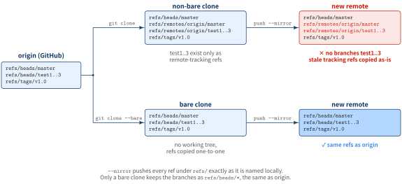

::: {.callout-note}
## TL;DR

- To copy a repository with its full history into another remote, use `git clone --bare` followed by `git push --mirror`
- `--mirror` pushes every ref under `refs/` exactly as it is named locally, so the local refs must look like origin's
- Use a bare clone, not a normal one: a normal clone keeps `test1`–`test3` only as `refs/remotes/origin/*`, so the new remote never gets them as branches
- The old remote is not touched; the copy is a snapshot, and later commits to the old remote are not synced

:::{.code-area}

```zsh
git clone --bare https://github.com/EXAMPLE-USER/LinearModels.git
cd LinearModels.git
git push --mirror https://gitlab.econometrics.com/EXAMPLE-USER/NEW-REPOSITORY.git
cd .. && rm -rf LinearModels.git
```

:::

:::


## Problem

Let’s say you are working on a GitHub-hosted repository, `LinearModels`, remotely and/or locally with your colleagues.
Development is going on at the current repository, but your boss has asked you to mirror the current
repository into gitlab repository, `https://gitlab.econometrics.com/EXAMPLE-USER/NEW-REPOSITORY.git`, while keeping the history as of now.

## Solution: git clone --bare

[Steps]{.mini-section}

1. Create a bare clone of the repository
2. Mirror-push to the new repository
3. Remove the temporary old local repository 

[Commands]{.mini-section}

```zsh
# Step 1
% git clone --bare https://github.com/EXAMPLE-USER/LinearModels.git

# Step 2
% cd LinearModels.git
% git push --mirror https://gitlab.econometrics.com/EXAMPLE-USER/NEW-REPOSITORY.git

# Step 3
% cd ..
% rm -rf LinearModels.git
```

:::{.blog-custom-border}
**📘 REMARKS**<br>

- A non-bare `git clone` downloads both the snapshot and history to the local machine. However, a `git clone --bare` only copies the history, allowing for a quicker transfer to a new remote repository.
- Additionally, you can create a non-bare repository from a bare repository. In most cases, when pushing, the new repository should be non-bare．
- The mirroring process is conducted through communication between the local and the new remote repository, so the old remote repository does not receive any notifications or updates of the new repository.

:::

### Why not no-bare git clone and git push --mirror?

When running `git clone origin-url`, you will get all of the tags copied,
a local branch master (`HEAD`) tracking a remote branch `origin/master`, and remote
branches `origin/test1`, `origin/test2`, and `origin/test3`. 

If you do `git push --mirror` a non-bare cloned repository, it also pushes your remote branches,
`origin/test1`, `origin/test2`, and `origin/test3`, because mirror implies everything.
Then, you would get branches named `origin/origin/test1`.

{fig-align="center" width="100%"}

[When do you mirror without --bare?]{.mini-section}

The bare clone is a means, not a rule. What `--mirror` needs is a repository whose refs already
look exactly like what the new remote should hold. Two common cases meet that without `git clone --bare`.

[Case 1: the local repository is the only copy]{.mini-section}

A project you started with `git init` and never pushed, or one whose old server is gone, has no
remote, so it has no `refs/remotes/*` to leak. Every branch already lives in `refs/heads/*`,
and you can mirror straight from your working repository.

:::{.code-area}

```zsh
# prints nothing → no remote-tracking refs
% git remote -v

% git push --mirror https://gitlab.econometrics.com/EXAMPLE-USER/NEW-REPOSITORY.git
```

:::

As soon as you add a remote and fetch from it, `refs/remotes/<name>/*` exists again and
`--mirror` pushes it too.

[Case 2: you keep the copy in sync — git clone --mirror]{.mini-section}

Sometimes the copy is not one-off: your team keeps committing to the old repository, and the new
remote has to catch up from time to time. For that, clone with `--mirror` instead of `--bare`.

Both give you a repository without a working tree. The difference shows up the *next* time you run
`git fetch`:

| | `git clone --bare` | `git clone --mirror` |
|---|---|---|
| `git fetch` afterwards | downloads, but **leaves your branches as they were** | **overwrites every branch and tag** with origin's latest |
| a branch added on origin later | not picked up | picked up |
| use it for | a one-time copy | a copy you refresh repeatedly |

So with `--mirror`, keeping the new remote up to date is just two commands, repeated whenever you
need: `git fetch` to catch up with origin, then `git push --mirror` to pass it on.

:::{.code-area}

```zsh
% git clone --mirror https://github.com/EXAMPLE-USER/LinearModels.git
% cd LinearModels.git
% git push --mirror https://gitlab.econometrics.com/EXAMPLE-USER/NEW-REPOSITORY.git

# later: pull in new commits, deleted branches included, then push again
% git fetch --prune origin
% git push --mirror https://gitlab.econometrics.com/EXAMPLE-USER/NEW-REPOSITORY.git
```

:::

:::{.blog-custom-border}
**📘 REMARKS**

- `--mirror` also **deletes** every ref on the new remote that does not exist locally. Push only into an empty repository, or one that nobody else pushes to.
- A `--mirror` clone of GitHub also fetches the read-only `refs/pull/*`. If the new remote is also on GitHub, the push rejects those refs with `deny updating a hidden ref`.

:::


References
----------
- [GitHub Docs > Duplicating a repository](https://docs.github.com/en/repositories/creating-and-managing-repositories/duplicating-a-repository)
