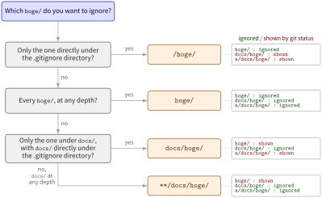

::: {.callout-note}
## TL;DR

- `hoge/` ignores **every** directory named `hoge`, at any depth (`hoge/`, `docs/hoge/`, `src/analysis_project/hoge/`, ...)
- `/hoge/` ignores **only** the `hoge/` directly under the directory that holds the `.gitignore` (the repository root for a top-level `.gitignore`)
- When you mean "the `hoge/` at the root", write `/hoge/`

:::{.code-area}

```bash
echo "/hoge/" >> .gitignore
```

:::

{fig-align="center" width="90%"}

:::


## 🎯 Goal

- [ ] Know which paths `hoge/` and `/hoge/` match


## 🔎 Objective

You keep local notes in a `hoge/` directory at the repository root and want Git to stop
showing it as untracked. Both of these look like the obvious fix:

:::{.code-area}

```bash
echo "hoge/"  >> .gitignore
echo "/hoge/" >> .gitignore
```

:::

They are not equivalent. If the project also has a `docs/hoge/` that you **do** want to
commit, the unanchored form silently hides it from `git status`, and nobody notices until
the docs go missing from the remote.


## How the leading slash changes the match

A `.gitignore` pattern without a leading (or middle) slash matches at **any level** below
the `.gitignore`. A leading slash anchors the pattern to the directory that contains the
`.gitignore`. The trailing slash in both forms only means "match directories, not files".

:::{.no-border-top-table .pb-3}

| Pattern | `hoge/` | `docs/hoge/` | `src/analysis_project/hoge/` |
|---|---|---|---|
| `hoge/` | ignored | ignored | ignored |
| `/hoge/` | ignored | **tracked** | **tracked** |

: {tbl-colwidths="[25,25,25,25]"}

:::


## What the official documentation says

The [Pattern Format](https://git-scm.com/docs/gitignore#_pattern_format) section of the
`gitignore` reference defines the rules behind the table above.

[Leading and middle slashes]{.mini-section}

> The slash "/" is used as the directory separator. Separators may occur at the beginning, middle or end of the .gitignore search pattern.
>
> If there is a separator at the beginning or middle (or both) of the pattern, then the pattern is relative to the directory level of the particular .gitignore file itself. Otherwise the pattern may also match at any level below the .gitignore level.

`/hoge/` has a separator at the beginning, so it is relative to the `.gitignore` itself.
`hoge/` has only a trailing separator, so it matches at any level.

[Trailing slash]{.mini-section}

> If there is a separator at the end of the pattern then the pattern will only match directories, otherwise the pattern can match both files and directories.
>
> For example, a pattern doc/frotz/ matches doc/frotz directory, but not a/doc/frotz directory; however frotz/ matches frotz and a/frotz that is a directory (all paths are relative from the .gitignore file).

The trailing slash restricts both `hoge/` and `/hoge/` to directories, so a regular file
named `hoge` is not ignored by either. Note the `doc/frotz/` example: a **middle** slash
anchors the pattern just like a leading one, so `docs/hoge/` matches only `docs/hoge/`
under the `.gitignore`, not `a/docs/hoge/`.

[Two consecutive asterisks]{.mini-section}

> Two consecutive asterisks ("**") in patterns matched against full pathname may have special meaning:
>
> - A leading "\*\*" followed by a slash means match in all directories. For example, "\*\*/foo" matches file or directory "foo" anywhere, the same as pattern "foo". "\*\*/foo/bar" matches file or directory "bar" anywhere that is directly under directory "foo".
> - A trailing "/\*\*" matches everything inside. For example, "abc/\*\*" matches all files inside directory "abc", relative to the location of the .gitignore file, with infinite depth.
> - A slash followed by two consecutive asterisks then a slash matches zero or more directories. For example, "a/\*\*/b" matches "a/b", "a/x/b", "a/x/y/b" and so on.

`**/hoge/` therefore behaves the same as `hoge/`. Use the `**` form when the pattern needs a
middle slash but should still match at any depth, e.g. `**/docs/hoge/` matches both
`docs/hoge/` and `a/docs/hoge/`.

## Walking through

Start from a repository with a `hoge/` at the root and another one under `docs/`:

[Tracked files]{.mini-section}

:::{.code-area}

```zsh
% git ls-tree -r --name-only HEAD | tree --fromfile
.
├── docs
└── README.md
```

:::

[Working tree]{.mini-section}

:::{.code-area}

```zsh
% tree
.
├── docs
│   └── hoge
│       └── test.txt
├── README.md
└── hoge
    └── test.txt
```

:::

Without a `.gitignore`, both directories show up as untracked:

:::{.code-area}

```zsh
% git status -sb
## main
?? docs/hoge/
?? hoge/
```

:::

[With `hoge/`]{.mini-section}

Both directories disappear. `docs/hoge/` is gone too:

:::{.code-area}

```zsh
% echo "hoge/" > .gitignore
% git status -sb
## main
?? .gitignore
```

:::

[With `/hoge/`]{.mini-section}

Only the root `hoge/` is ignored. `docs/hoge/` is still visible and can be committed:

:::{.code-area}

```zsh
% echo "/hoge/" > .gitignore
% git status -sb
## main
?? .gitignore
?? docs/hoge/
```

:::


References
----------
- [`gitignore` — Git Reference > Pattern Format](https://git-scm.com/docs/gitignore#_pattern_format)
