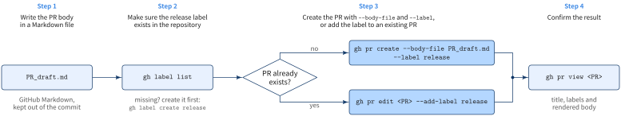

::: {.callout-note}
## TL;DR

- `gh pr create --base <into> --head <from> --title "..."` opens a pull request without leaving the terminal
- Write the description in a Markdown file and pass it with `--body-file`; the file is sent as-is and rendered as GitHub Flavored Markdown
- `--label release` attaches a label at creation; for an existing PR use `gh pr edit <PR number> --add-label release`

:::{.code-area}

```bash
gh pr create --base main --head develop --title "Release 0.1.0" \
  --body-file PR_draft_2026-10-29.md \
  --label release
```

:::

{fig-align="center" width="96%"}

:::


## 🎯 Goal

- [ ] Create a pull request with `gh pr create`
- [ ] Write a PR body in a Markdown file that renders the way you expect
- [ ] Attach a label at creation, or to a PR that already exists


## 🔎 Objective

You open a release pull request from `develop` into `main`. The description is long enough
that `--body "..."` on the command line is painful, and the repository expects every release
PR to carry the `release` label. Opening the browser to paste the description and click the
label is the step you want to drop.


## Solution: using `gh pr create`

::: {.callout-note}

### Steps

1. Write the PR body in a Markdown file
2. Make sure the `release` label exists in the repository
3. Create the PR with `--body-file` and `--label`, or add the label to an existing PR
4. Confirm the result

:::


[Step 1: write the body]{.mini-section}

- Keep the draft outside the working tree, or in an ignored directory, so it never ends up in the commit you are about to propose
- See the next section for what to watch in the file itself.

[Step 2: check the label]{.mini-section}

:::{.code-area}

```bash
gh label list
```

:::

If `release` is not in the list, create it first:

:::{.code-area}

```bash
gh label create release
```

:::

[Step 3a: create the PR with the label]{.mini-section}

:::{.code-area}

```bash
gh pr create --base main --head develop --title "Release 0.1.0" \
  --body-file PR_draft_2026-10-29.md \
  --label release
```

:::

Add `--dry-run` first to print what would be created without opening the PR.

[Step 3b: add the label to an existing PR]{.mini-section}

:::{.code-area}

```bash
gh pr edit <PR number> --add-label release
```

:::

[Step 4: verify]{.mini-section}

:::{.code-area}

```bash
gh pr view <PR number>
```

:::

The output shows the title, the labels, and the body rendered as Markdown.

::: {.callout-tip}
## `--label` and `--add-label` accept several labels

Repeat the flag or separate names with commas, e.g. `--label "release,documentation"`.
`gh pr edit` also has `--remove-label` for the opposite operation.
:::


## Writing the body file

`--body-file` sends the file content verbatim. GitHub renders it as GitHub Flavored Markdown,
so anything that only makes sense locally ends up on the PR page as-is.

:::{.no-border-top-table .pb-3}

| What you write | What happens on GitHub | Do this instead |
|---|---|---|
| `# Release 0.1.0` as the first line | Repeated under the PR title, which comes from `--title` | Start with `## Summary` or plain text |
| YAML front matter (`---` ... `---`) | Not hidden; the `---` lines render as rules or turn the line above into a heading | Drop it |
| `` | Broken image; local paths are not uploaded | Attach the file with `--attach` or upload it in the browser (see [Putting images in the body](#putting-images-in-the-body)) |
| `@name` | The user or team is notified | Wrap it in backticks when you do not mean to ping |
| `Closes #12` | Issue #12 is closed when the PR merges into the default branch | Write `Refs #12` when it should stay open |

: {tbl-colwidths="[30,35,35]"}

:::

[Example: PR_draft_2026-10-29.md]{.mini-section}

The file starts at `##`, since `--title "Release 0.1.0"` already supplies the heading, and
groups changes in [Keep a Changelog](https://keepachangelog.com/) categories.

:::{.code-area}

```markdown
## Summary

Release 0.1.0: merge `develop` into `main`.

## Changes

### Added

- `gh` helper script for opening release PRs (#21)

### Changed

- Bump minimum Python version to 3.11 (#18)

### Fixed

- Crash when the config file is empty (#19)

## Checklist

- [ ] Version in `pyproject.toml` is `0.1.0`
- [ ] CI is green on `develop`

Refs #12
```

:::

The `- [ ]` items render as checkboxes that reviewers can tick on the PR page, and `(#21)`
turns into a link to that PR or issue.

::: {.callout-warning}
## The file is not the title

Unlike `gh pr create --editor`, where the first line becomes the title, `--body-file` never
reads a title from the file. Without `--title`, gh prompts for one, or fails in a
non-interactive shell.
:::


## Putting images in the body

- A local path such as `` in the body file points at nothing on GitHub.
- The image has to be uploaded first

There are two ways.

[Option 1: `--attach`]{.mini-section}

`gh pr create` and `gh pr edit` take `--attach <file>`. gh uploads the file, and any
reference to it in the body is rewritten to the uploaded URL.

:::{.code-area}

```markdown
## Screenshots


```

:::

:::{.code-area}

```bash
gh pr create --base main --head develop --title "Release 0.1.0" \
  --body-file PR_draft_2026-10-29.md \
  --label release \
  --attach ./figures/before.png \
  --attach ./figures/after.png
```

:::

[What `gh pr create --help` says]{.mini-section}

> Use `--attach` to upload an image or video. The attachment is appended to the
> body. If the body references an attached file, such as ``, that
> reference is rewritten to point at the uploaded asset instead. Paths in a
> `--body-file` are relative to its directory, falling back to the working directory.
> You can attach up to 50 files per command.
>
> Alt text for an image follows the path after `#`, as in
> `--attach './login.png#The login error state'`. Without it the filename is used.
> A reference already in the body keeps the alt text written there. Video renders
> as a player and has no alt text, so it cannot be given any.

In practice:

- Paths in the body are resolved relative to the body file's directory, then the working directory
- A file you attach but do not reference in the body is appended to the end of the body
- Set alt text for an unreferenced file with `#`: `--attach './figures/after.png#After the fix'`
- For an existing PR: `gh pr edit <PR number> --attach ./figures/after.png` appends it to the current body

::: {.callout-note}
## Attached images are not tracked by Git

Attaching a file does **not** make it a Git-tracked file: it is not staged, not committed,
and not pushed with the branch. `--attach` uploads to GitHub's attachment storage (`https://github.com/user-attachments/assets/...`),
not to the repository, and `gh pr create` never runs `git add`. The local files only end up in
a commit if you add them yourself, so keep them next to the body file, outside the repository
or in an ignored directory.
:::


[Option 2: upload in the browser]{.mini-section}

1. Open the PR (`gh pr view <PR number> --web`) and choose **Edit** from the `...` menu of the description
2. Drag and drop the image into the text area, or paste it from the clipboard
3. GitHub uploads it and inserts a line such as ``
4. Click **Update comment**

Copy that inserted line back into your local body file if you plan to resend the body later with
`gh pr edit <PR number> --body-file ...`; otherwise the next edit overwrites the image.
