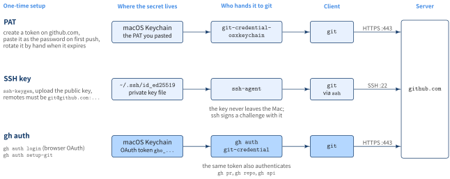
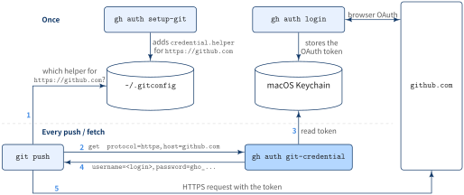

::: {.callout-note}
## TL;DR

- Install Git and GitHub CLI with Homebrew, log in once with `gh auth login`, and let `gh auth setup-git` register gh as Git's credential helper
- **No PAT to copy, no SSH key to upload**: the OAuth token lives in the macOS Keychain, and `git push` asks gh for it on every HTTPS request
- `--git-protocol https` tells gh to use `https://` URLs whenever it runs Git for you; it does not rewrite remotes you already have

:::{.code-area}

```zsh
brew install git
brew install gh
gh auth login --git-protocol https
gh auth setup-git
gh auth status
```

:::

:::


## 🎯 Goal

- [ ] Push to and pull from GitHub over HTTPS on a fresh Mac without creating a PAT or an SSH key
- [ ] Know how PAT, SSH, and gh auth differ, and how `git` gets the token from `gh`


## 🔎 Objective

You set up a new Mac and clone a private repository. The classic options are a personal access
token (PAT) pasted as the password, or an SSH key registered on github.com. Both take a trip
to the browser, and the PAT comes back to bite you when it expires.

GitHub CLI already holds a token after `gh auth login`. The setup below hands that same token
to `git`, so one login covers both `gh pr create` and `git push`.


## Solution: using `gh auth`

::: {.callout-note}

### Steps

0. Install Git
1. Install GitHub CLI
2. Log in to GitHub
3. Use GitHub CLI for Git authentication
4. Check the authentication state

:::


[Step 0: install Git]{.mini-section}

:::{.code-area}

```zsh
brew install git
```

:::

macOS ships `/usr/bin/git` with the Xcode Command Line Tools. Homebrew installs a newer one
under `/opt/homebrew/bin` (Apple Silicon) or `/usr/local/bin` (Intel). Make sure the shell
picks the Homebrew one:

:::{.code-area}

```zsh
which git        # /opt/homebrew/bin/git
git --version
```

:::

[Step 1: install GitHub CLI]{.mini-section}

:::{.code-area}

```zsh
brew install gh
```

:::

[Step 2: log in to GitHub]{.mini-section}

:::{.code-area}

```zsh
gh auth login --git-protocol https
```

:::

gh asks a few questions. Pick GitHub.com, answer **Yes** to "Authenticate Git with your GitHub
credentials?", and choose the web browser. gh prints a one-time code, opens
`https://github.com/login/device`, and you paste the code there to authorize GitHub CLI.

:::{.code-area}

```text
? Where do you use GitHub? GitHub.com
? Authenticate Git with your GitHub credentials? Yes
? How would you like to authenticate GitHub CLI? Login with a web browser

! First copy your one-time code: XXXX-XXXX
Press Enter to open https://github.com/login/device in your browser...
✓ Authentication complete.
- gh config set -h github.com git_protocol https
✓ Configured git protocol
✓ Logged in as <your-login>
```

:::

The resulting OAuth token (prefix `gho_`) goes into the macOS Keychain, not into a plain-text file.

[Step 3: use GitHub CLI for Git authentication]{.mini-section}

:::{.code-area}

```zsh
gh auth setup-git
```

:::

This adds the following to `~/.gitconfig`:

:::{.code-area}

```ini
[credential "https://github.com"]
	helper =
	helper = !/opt/homebrew/bin/gh auth git-credential
[credential "https://gist.github.com"]
	helper =
	helper = !/opt/homebrew/bin/gh auth git-credential
```

:::

Answering **Yes** in Step 2 already writes the same lines. Running `gh auth setup-git`
explicitly is harmless and covers the case where you answered No, or logged in with
`--with-token`.

[Step 4: check the authentication state]{.mini-section}

:::{.code-area}

```zsh
gh auth status
```

:::

:::{.code-area}

```text
github.com
  ✓ Logged in to github.com account <your-login> (keyring)
  - Active account: true
  - Git operations protocol: https
  - Token: gho_************************************
  - Token scopes: 'gist', 'read:org', 'repo'
```

:::

`(keyring)` means the token is in the macOS Keychain. `Git operations protocol: https` is the
value set by `--git-protocol`. To confirm `git` will ask gh, list the helpers for github.com
and where each one comes from:

:::{.code-area}

```zsh
git config --show-origin --get-all credential.https://github.com.helper
```

:::


## PAT vs SSH vs gh auth

All three end with `git` proving to github.com who you are. They differ in what you set up,
where the secret sits, and what hands it to `git`.

{fig-align="center" width="100%"}

:::{.no-border-top-table .pb-3}

| | PAT | SSH key | gh auth |
|---|---|---|---|
| Setup | Create a token on github.com, paste it at the first push | `ssh-keygen`, upload the public key | `gh auth login` + `gh auth setup-git` |
| Remote URL | `https://github.com/...` | `git@github.com:...` | `https://github.com/...` |
| Port | 443 | 22 (often blocked on corporate networks) | 443 |
| Expiry | Whatever you chose; rotate by hand | None | Managed by gh; log in again to replace |
| Also authenticates `gh` | No | No | Yes, same token |

: {tbl-colwidths="[16,28,28,28]"}

:::

The PAT and gh auth rows look alike on the wire: both send a token over HTTPS. The difference
is who produced the token and who keeps it. With a PAT you create it, copy it, and the
`osxkeychain` helper caches whatever you pasted. With gh auth, gh obtains the token through
the browser and gh itself answers when `git` asks.


## How `gh auth` plugs into `git`

`git` never talks to GitHub CLI directly. It has a generic hook, the
[credential helper](https://git-scm.com/docs/gitcredentials): when an HTTPS remote needs a
username and password, `git` runs the helper configured for that URL and reads the answer from
its standard output. `gh auth setup-git` registers `gh auth git-credential` as that helper for
`https://github.com`.

{fig-align="center" width="92%"}

[Once]{.mini-section}

- `gh auth login` runs the browser OAuth flow and stores the token in the macOS Keychain
- `gh auth setup-git` writes the `credential.helper` entry into `~/.gitconfig`

[Every push / fetch]{.mini-section}

1. `git` looks up the helper for `https://github.com` in `~/.gitconfig`
2. It runs `gh auth git-credential get` and writes `protocol=https` and `host=github.com` to its stdin
3. gh reads the token for that host from the Keychain
4. gh prints `username=<your-login>` and `password=gho_...`
5. `git` sends the HTTPS request with that token

Because gh answers on every request, `gh auth login` again, or `gh auth refresh -s <scope>`,
takes effect for `git` immediately. There is no second copy of the token to update.

::: {.callout-tip}
## Why the empty `helper =` line

Both Homebrew's Git and Apple's Git ship a system-level `credential.helper = osxkeychain`.
Git calls every configured helper in order, so without a reset an old PAT cached in the
Keychain could still answer first. An empty `helper =` clears the list for that URL, leaving
gh as the only helper for `https://github.com`.
:::


## What `--git-protocol https` means

`--git-protocol` (short form `-p`) answers one question: when gh runs Git on your behalf, which
URL form should it use for this host? The value is saved per host in gh's config.

:::{.code-area}

```zsh
gh config get git_protocol -h github.com   # https
```

:::

:::{.no-border-top-table .pb-3}

| | `--git-protocol https` | `--git-protocol ssh` |
|---|---|---|
| `gh repo clone owner/repo` | clones `https://github.com/owner/repo.git` | clones `git@github.com:owner/repo.git` |
| `gh repo fork --clone`, `gh repo create --clone` | sets remotes to `https://` | sets remotes to `git@` |
| Extra step during `gh auth login` | offers to set up gh as Git's credential helper | looks for an SSH key and offers to create and upload one (`--skip-ssh-key` to skip) |

: {tbl-colwidths="[30,35,35]"}

:::

Passing the flag also skips the "preferred protocol" prompt during login.

It does **not** change how gh talks to the GitHub API (always HTTPS), and it does not touch
plain `git clone` commands or existing remotes.

::: {.callout-warning}
## Existing SSH remotes keep using SSH

A repository cloned earlier as `git@github.com:owner/repo.git` still goes through SSH after
this setup, and fails if you have no SSH key on the new Mac. Check the remote and switch it
to HTTPS:

:::{style="padding-left:1em;"}

```zsh
git remote -v
git remote set-url origin https://github.com/<owner>/<repo>.git
```

:::

:::
