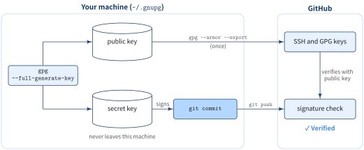
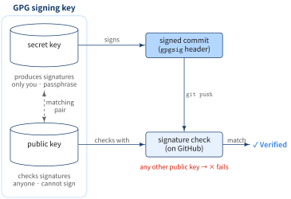
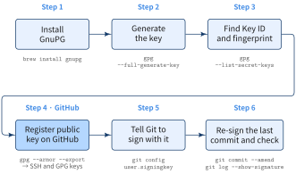
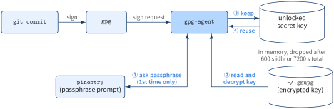

::: {.callout-note}
## TL;DR

- A GPG signing key is a key pair: the **secret key** stays in `~/.gnupg` and signs your commits, the **public key** goes to GitHub and verifies them
- GitHub shows **Verified** only when (1) the commit is signed, (2) the public key is registered, and (3) the key's email matches a verified email on your account
- Point `user.signingkey` at the primary key's 40-character fingerprint, not the email

:::{.code-area}

```zsh
brew install gnupg

# (9) ECC → (1) Curve 25519 → 1y
gpg --full-generate-key

# find the fingerprint
gpg --list-secret-keys --keyid-format LONG

# paste into GitHub → SSH and GPG keys
gpg --armor --export <FINGERPRINT>

git config --global user.signingkey <FINGERPRINT>
git config --global commit.gpgsign true
```

:::

:::


## 🎯 Goal

- [ ] Know what a GPG signing key is
- [ ] Generate a key with sensible choices at each `gpg --full-generate-key` prompt
- [ ] Know where GnuPG writes the key and how to read Key ID vs fingerprint
- [ ] Get **Verified** on GitHub for new commits, and re-sign the last unsigned one


## 🔎 Objective

`git config user.email` is a free-text field. Anyone can set it to your address and push a
commit that GitHub attributes to you. A signature fixes that: the commit carries proof that it
was made by someone holding your secret key.

{fig-align="center" width="100%"}

Only the public key ever leaves your machine. **Never upload the secret key to GitHub.**


## What is a GPG signing key?

GPG ([GnuPG](https://gnupg.org/)) is the standard implementation of OpenPGP, a format for
signing and encrypting data with public-key cryptography. A **GPG signing key** is an OpenPGP
key pair whose job is to sign:

- **Secret key**: produces signatures. Only you have it, protected by a passphrase
- **Public key**: checks signatures. Anyone can have it; it cannot produce a signature

A signature made with the secret key verifies only against the matching public key. So when
GitHub checks a commit against the public key on your account and the check passes, the
commit was signed by whoever holds your secret key.

{fig-align="center" width="100%"}

[What gets signed]{.mini-section}

A commit is a small text object: tree, parents, author, committer, and message. With signing
on, Git passes that text to `gpg`, and stores the signature it gets back in the commit itself,
under a `gpgsig` header:

:::{.code-area}

```zsh
git cat-file -p HEAD
```

:::

:::{.code-area}

```text
tree 9bc4a1...
parent 3f1e0d...
author Ryo Nakagami <ryo@example.com> 1793754000 +0900
committer Ryo Nakagami <ryo@example.com> 1793754000 +0900
gpgsig -----BEGIN PGP SIGNATURE-----
 ...
 -----END PGP SIGNATURE-----

Add test.md
```

:::

Change one byte of the author, message, or tree, and the signature no longer matches. That
is why `git commit --amend` has to sign again, and why the commit ID changes.

[Signing key vs SSH key / token]{.mini-section}

:::{.no-border-top-table .pb-3}

| | SSH key / token | GPG signing key |
|---|---|---|
| Proves | Who is **pushing** to GitHub | Who **made** the commit |
| Checked | Once per connection | On every commit, forever |
| Travels with the commit | No | Yes, inside the commit object |

: {tbl-colwidths="[30,35,35]"}

:::

A push credential lets you push anyone's commits. A signature stays on each commit, so it
still means something after the commit is pushed, fetched by someone else, or mirrored to
another host.


## How to set up a GPG signing key

::: {.callout-note}

### Steps

{fig-align="center" width="100%"}

:::


[Step 1: install GnuPG]{.mini-section}

:::{.code-area}

```zsh
brew install gnupg
```

:::

[Step 2: generate the key]{.mini-section}

:::{.code-area}

```zsh
gpg --full-generate-key
```

:::

gpg walks through several prompts. The first one picks the algorithm:

:::{.code-area}

```text
Please select what kind of key you want:
   (1) RSA and RSA
   (2) DSA and Elgamal
   (3) DSA (sign only)
   (4) RSA (sign only)
   (9) ECC (sign and encrypt) *default*
  (10) ECC (sign only)
  ...
Your selection? 9
```

:::

:::{.no-border-top-table .pb-3}

| Choice | What it creates | For commit signing |
|---|---|---|
| (1) RSA and RSA | RSA keys for signing and encryption | Works |
| (4) RSA (sign only) | RSA signing key only | Works |
| (9) ECC (sign and encrypt) | Elliptic-curve signing key + encryption subkey | **Recommended** (default) |
| (10) ECC (sign only) | Elliptic-curve signing key only | Enough if you only sign commits |

: {tbl-colwidths="[30,40,30]"}

:::

Next comes the curve:

:::{.code-area}

```text
Please select which elliptic curve you want:
   (1) Curve 25519 *default*
   (4) NIST P-384
   (6) Brainpool P-256
Your selection? 1
```

:::

:::{.no-border-top-table .pb-3}

| Choice | Curve | When to pick it |
|---|---|---|
| (1) | Curve 25519 | Fast, widely supported. **Recommended** |
| (4) | NIST P-384 | You must comply with NIST standards |
| (6) | Brainpool P-256 | You have a specific Brainpool requirement |

: {tbl-colwidths="[15,25,60]"}

:::

With (9) + (1) you get two keys: an **Ed25519** primary key that signs commits, and a
**Cv25519** subkey for encryption. Pressing Enter at both prompts gives the same result.

The remaining prompts:

1. Expiry: `1y` is a reasonable default; you can extend it later with `gpg --edit-key`
2. Real name: `Ryo Nakagami`
3. Email address: an email that is **verified on your GitHub account** (the `noreply` address works too)
4. Confirm with `O`
5. Passphrase: protects the secret key on disk; `gpg-agent` caches the unlocked key after the first use (see the Appendix)

[Where did gpg write the key?]{.mini-section}

Everything goes under the GnuPG home directory:

:::{.code-area}

```zsh
gpgconf --list-dirs homedir
# /Users/<you>/.gnupg
```

:::

:::{.code-area}

```text
~/.gnupg/
├── pubring.kbx                  # public keys (yours and any you imported)
├── private-keys-v1.d/
│   └── <KEYGRIP>.key            # secret keys, one file per key / subkey
├── openpgp-revocs.d/
│   └── <FINGERPRINT>.rev        # revocation certificate, created automatically
└── trustdb.gpg                  # trust levels ([ultimate] for your own key)
```

:::

Back up `private-keys-v1.d/` and the `.rev` file somewhere offline. The revocation certificate
is what you publish if the secret key leaks.

[Step 3: find the Key ID and fingerprint]{.mini-section}

:::{.code-area}

```zsh
gpg --list-secret-keys --keyid-format LONG
```

:::

:::{.code-area}

```text
sec   ed25519/1234567890ABCDEF 2026-11-04 [SC] [expires: 2027-11-04]
      ABCDEF1234567890ABCDEF1234567890ABCDEF12
uid                 [ultimate] Ryo Nakagami <ryo@example.com>
ssb   cv25519/9876543210FEDCBA 2026-11-04 [E] [expires: 2027-11-04]
```

:::

(Fictional values.) `gpg --list-keys --keyid-format LONG` prints the same layout with `pub` /
`sub` for the public halves.

:::{.no-border-top-table .pb-3}

| Field | Example | Meaning |
|---|---|---|
| `sec` | `ed25519/...` | Secret primary key |
| `ssb` | `cv25519/...` | Secret subkey |
| `uid` | `Ryo Nakagami <ryo@example.com>` | User ID: who owns the key |
| Key ID | `1234567890ABCDEF` | 16 hex digits after the `/`; the last 64 bits of the fingerprint |
| Fingerprint | `ABCDEF1234...EF12` | 40 hex digits on the line below `sec`; the full identifier |
| `[S]` / `[C]` / `[E]` | | Signing / Certification / Encryption |

: {tbl-colwidths="[20,35,45]"}

:::

The primary key is `[SC]`, so it is the one that signs commits. To print only the fingerprint:

:::{.code-area}

```zsh
gpg --fingerprint

# or, for scripts (one line per key, so the subkey's fingerprint shows up too)
gpg --list-secret-keys --with-colons | awk -F: '$1 == "fpr" {print $10}'
```

:::

[Step 4: register the public key on GitHub]{.mini-section}

:::{.code-area}

```zsh
gpg --armor --export <FINGERPRINT>
```

:::

:::{.code-area}

```text
-----BEGIN PGP PUBLIC KEY BLOCK-----

...

-----END PGP PUBLIC KEY BLOCK-----
```

:::

Copy the whole block, including the `BEGIN` / `END` lines, into
**GitHub → Settings → SSH and GPG keys → New GPG key**.

[Step 5: tell Git to sign with it]{.mini-section}

:::{.code-area}

```zsh
git config --global gpg.format openpgp
git config --global user.signingkey <FINGERPRINT>
git config --global commit.gpgsign true
```

:::

`user.signingkey` also accepts the 16-digit Key ID, as in
[GitHub's guide](https://docs.github.com/en/authentication/managing-commit-signature-verification/telling-git-about-your-signing-key),
but the fingerprint cannot collide with another key in your keyring.

The committer email must match the key's `uid`, and GitHub must have it as a verified email:

:::{.code-area}

```zsh
git config --global user.name "Ryo Nakagami"
git config --global user.email "<YOUR_GITHUB_EMAIL>"
```

:::

Check all four values at once:

:::{.code-area}

```zsh
git config --global --get gpg.format        # openpgp
git config --global --get user.signingkey   # <FINGERPRINT>
git config --global --get commit.gpgsign    # true
git config --global --get user.email        # same email as the key's uid
```

:::

::: {.callout-warning}
## `error: gpg failed to sign the data`

gpg needs a terminal to ask for the passphrase. If `git commit` fails with this error, tell
gpg which TTY to use and add the line to `~/.zshrc`:

:::{style="padding-left:1em;"}

```zsh
export GPG_TTY=$(tty)
```

:::

:::

[Step 6: re-sign the last commit and check it]{.mini-section}

A commit made before this setup has no signature, and possibly the wrong author email.
Rewrite it with the current config:

:::{.code-area}

```zsh
git commit --amend --reset-author --no-edit
```

:::

`--reset-author` takes the author from the current `user.name` / `user.email`, and because
`commit.gpgsign` is `true`, the new commit is signed.

::: {.callout-warning}
## `--amend` changes the commit ID

The amended commit is a new object. Don't run this on a commit that is already pushed to a
shared branch.
:::

Check the author, committer, and signature:

:::{.code-area}

```zsh
git log -1 --format=fuller
git log -1 --show-signature
```

:::

:::{.code-area}

```text
gpg: Signature made Wed Nov  4 10:00:00 2026 JST
gpg:                using EDDSA key ABCDEF1234567890ABCDEF1234567890ABCDEF12
gpg: Good signature from "Ryo Nakagami <ryo@example.com>" [ultimate]
```

:::

`Good signature` means the local check passed. After `git push`, GitHub shows **Verified** next
to the commit once it matches the public key you registered in Step 4.


## Appendix: Why does gpg ask for the passphrase only once?

The passphrase is for **signing**, not for verifying. The secret key sits encrypted in
`~/.gnupg/private-keys-v1.d/`, and each signature needs the decrypted key. Verifying (on
GitHub or with `git log --show-signature`) uses only the public key, so it never asks.

You type the passphrase once because `gpg` does not sign by itself. It hands the work to
`gpg-agent`, a background process that keeps the decrypted key in memory for a while.

{fig-align="center" width="100%"}

[First commit]{.mini-section}

1. `git commit` runs `gpg`, and `gpg` asks `gpg-agent` to sign
2. `gpg-agent` has no unlocked key, so it opens `pinentry` and asks for the passphrase (①)
3. It reads the encrypted key from `~/.gnupg` and decrypts it with the passphrase (②)
4. It signs, and keeps the unlocked key in memory (③)

[Next commits]{.mini-section}

`gpg-agent` signs with the key it already holds (④). No prompt, no disk read.

[How long "once" lasts]{.mini-section}

The cache has two timers, set in `~/.gnupg/gpg-agent.conf`:

:::{.code-area}

```conf
# seconds since the key was last used; every use resets it (default: 10 minutes)
default-cache-ttl 600

# seconds since the passphrase was entered; using the key does not extend it (default: 2 hours)
max-cache-ttl 7200
```

:::

Either timer running out drops the key, and the next commit asks again. So "once" means once
per cache window: after 10 minutes without a commit, or 2 hours after you typed it.

:::{.code-area}

```zsh
# reload after editing gpg-agent.conf
gpgconf --reload gpg-agent

# drop the cached key now; the next signature asks again
gpgconf --kill gpg-agent
```

:::

::: {.callout-tip}
## Storing the passphrase in the macOS Keychain

With `pinentry-mac`, the prompt has a **Save in Keychain** checkbox. Once checked,
`pinentry-mac` answers from the Keychain and you are not asked even after the cache expires.

:::{style="padding-left:1em;"}

```zsh
brew install pinentry-mac
echo "pinentry-program $(brew --prefix)/bin/pinentry-mac" >> ~/.gnupg/gpg-agent.conf
gpgconf --kill gpg-agent
```

:::

:::
